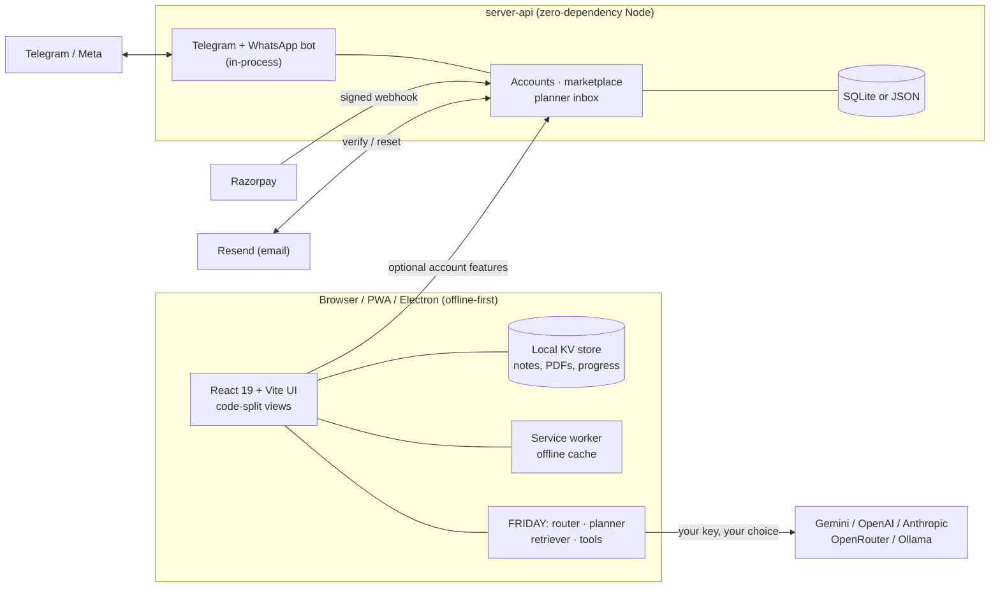

<div align="center">


# Notes Maker AI

**An offline-first AI study workspace built for Indian students.**
Notes that read themselves aloud · 200+ interactive STEM simulations · one multi-agent assistant (FRIDAY) · study tools in six languages · your data stays on your device.

[](https://github.com/helloAi0/NotesMakerAI/actions/workflows/ci.yml)


[Quick start](#-quick-start) · [Features](#-features) · [Architecture](#-architecture) · [Deploy](#-deploy-on-render) · [Testing](#-testing) · [Security](#-security-and-privacy) · [Roadmap](#-roadmap-and-honest-limits)

</div>

---

## Why this exists

Most study apps assume fast internet, English-first content and a paid AI subscription. Notes Maker AI starts from the opposite assumptions: **it works offline, it speaks the student's language, and it never needs an account to start.** AI is optional and bring-your-own-key, so a student with no key still gets a fully working notebook, planner, simulations, flashcards and a built-in knowledge assistant.

> **Honest positioning.** FRIDAY is a set of coordinated AI helpers (router, planner, retrieval, tools), **not AGI**. It can be wrong; check important answers against your textbook.

## ✨ Features

| Area | What you get |
|---|---|
| **Notebook** | Rich notes, folders, Draw tab with offline handwriting recognition, dictation with spoken formatting ("new line", "bullet"), **click any word to be read aloud from there**. |
| **FRIDAY assistant** (Alt+A) | Operates the app from typed or spoken commands chained with `->`; answers from a STEM glossary, all simulations, your notes and PDFs (BM25 retrieval with sources); calculator; plugs into Gemini, OpenAI, Anthropic, OpenRouter, or a local Ollama model. Multi-agent mode with planner, retriever, tutor and critic. |
| **Visuals Studio** | **200+ interactive simulations**, Class 8 to postgraduate, with a curriculum-coverage view and prediction mode. |
| **Lecture to Notes** | Turn a recording, transcript or YouTube lecture into structured notes. |
| **Study Studio** (8 tools) | Bhasha language flip · JEE/NEET/UPSC/GATE engines · Handwriting→LaTeX · Voice tutor you can interrupt · Python code visualizer · Tinder-style swipe recall · Notes marketplace · Telegram/WhatsApp bot. |
| **Practice & progress** | Quizzes, spaced repetition, streaks, study planner, dashboard. |
| **Study rooms** | Peer-to-peer (WebRTC) rooms, no media server. |
| **Platform** | Class and teacher tools, analytics, PWA install, full offline cache, desktop app (Electron). |
| **3D landing page** | three.js scene loaded only for first-time visitors, with reduced-motion and no-WebGL fallbacks. |

### Study Studio in detail

| Tool | Highlights |
|---|---|
| **Bhasha** | Flips notes into Hindi, Marathi, Bengali, Tamil or Telugu while **protecting formulas and technical terms**; chunking, retry, safe fallback to the English original. |
| **Exam engines** | Board-aware notes and memory tricks; paste your own previous-year questions to find recurring patterns (nothing is bundled). |
| **Handwriting → LaTeX** | Photo of maths → editable, KaTeX-checked LaTeX and a dependency graph. |
| **Voice tutor** | Say "wait", "explain again", "give an example", "slower" mid-sentence in English, Hindi, Marathi, Bengali, Tamil or Telugu. |
| **Code visualizer** | Safe built-in Python interpreter: exact big integers, Python-style floats, classes, sets, try/except, comprehensions, `math`/`collections`/`heapq`; step-through with variables, heap and call stack. |
| **Swipe recall** | Left = see it again tomorrow, right = push it out; undo; spaced scheduling. |
| **Notes marketplace** | Creators sell notes; buyers pay by UPI link or online (Razorpay); notes unlock only after confirmed payment. |
| **Chat bot** | Send a link, voice note or "remind me…" to Telegram or WhatsApp; it lands in your planner. |

## 🏗 Architecture



**Design principles**

1. **Offline first.** Everything core works with no network and no account; the server is optional.
2. **Local data.** Notes, PDFs and progress stay on the device. AI keys live only in the browser and go only to the provider the user chose.
3. **Small first load.** Heavy libraries (three.js, KaTeX, PDF, OCR, simulations) are lazy chunks under a CI-enforced budget (~410 KB gzip initial).
4. **Zero-dependency server.** `server-api` uses only Node built-ins: tiny attack surface, trivial to audit and deploy.
5. **Honest AI.** Retrieval shows sources; failure states say what went wrong; nothing pretends to be AGI.

### Repository layout

```
frontend/      React 19 · Vite 8 · TypeScript 6 · Tailwind 3 (the web app, PWA)
  src/sims/    200+ simulations, auto-registered via defineSim()
  src/lib/     FRIDAY, voice, OCR, i18n, study tools, platform
  tools/       unit tests (tsx), Playwright e2e suites, fuzzers, perf budget
server-api/    Accounts, marketplace, payments webhook, bot, SQLite store (Node ≥22)
desktop/       Electron wrapper (Windows, macOS, Linux)
ai-service/    Optional FastAPI service
backend-cpp/   Optional C++ backend experiments
docs/          Demo GIF and the detailed feature guide (docs/GUIDE.md)
render.yaml    One-click Render Blueprint
```

## 🚀 Quick start

Requirements: **Node 22+** (Node 20 works for everything except SQLite storage).

```bash
git clone https://github.com/helloAi0/NotesMakerAI.git
cd NotesMakerAI/frontend
npm install
npm run dev          # http://localhost:5173
```

* Microphone features need `localhost` or HTTPS; use Chrome or Edge for dictation.
* Add an AI key **inside the app** (Settings). Never commit keys.
* After pulling new code, `npm run dev` installs any newly added packages automatically.

### Optional: run the accounts / marketplace / bot server

```bash
cd server-api
NM_SECRET=$(openssl rand -hex 32) NM_ORIGIN=http://localhost:5173 node server.mjs   # :8787
```

Copy [`.env.example`](.env.example) for every setting. Key ones:

| Variable | Purpose |
|---|---|
| `NM_SECRET` | Signs sessions (32+ chars, required) |
| `NM_ORIGIN` / `NM_APP_URL` | Allowed web origin / base URL used in emails |
| `NM_DATA` | `./data.json` (simple) or `./data.sqlite` (durable, transactional) |
| `NM_BOT_KEY` + `TELEGRAM_TOKEN` | Runs the Telegram bot inside the server |
| `WA_TOKEN`, `WA_PHONE_ID`, `WA_APP_SECRET`, `WA_VERIFY_TOKEN` | WhatsApp Cloud API (webhook: `/webhooks/whatsapp`) |
| `RZP_KEY_ID`, `RZP_KEY_SECRET`, `RZP_WEBHOOK_SECRET` | Razorpay online payments (webhook: `/webhooks/razorpay`) |
| `RESEND_API_KEY`, `NM_MAIL_FROM` | Email verification and password reset |

Run `node bot.mjs --check` to verify your Telegram/WhatsApp/server setup in seconds without sending any message.

## ☁️ Deploy on Render

1. Push to GitHub, then **Render → New + → Blueprint** and select this repo. [`render.yaml`](render.yaml) creates:
   * `notes-maker-web`: static site built by Vite, with security headers, strict CSP and SPA rewrite.
   * `notes-maker-server`: Node service with `/healthz`, a persistent disk and SQLite.
2. Set `NM_ORIGIN`/`NM_APP_URL` (web URL) on the server and `VITE_API_BASE` (server URL) on the web app, then redeploy the web app.
3. Optionally add Telegram, WhatsApp, Razorpay and Resend keys (all `sync: false`, entered only in the Render dashboard).
4. The Render **free** tier has no persistent disk, so accounts reset on redeploy; use the paid disk for real users.

## 🧪 Testing

| Layer | Command | Covers |
|---|---|---|
| Types / lint | `npx tsc -b` · `npx eslint src server --quiet` | Strict TS (`verbatimModuleSyntax`, `erasableSyntaxOnly`) |
| Unit | `npm run test:unit` | Intents, FRIDAY, interpreters, i18n, Bhasha, OCR parsing, swipe scheduler, fuzzing (30,000 mutated programs) |
| Server | `npm run test:server` | 27 tests: auth, marketplace, Razorpay signature/replay, email flows, SQLite, **bot end-to-end against fake Telegram/Meta servers** |
| Browser e2e | `BASE=http://127.0.0.1:5300 npm run test:e2e` | 30 Playwright suites: every view, every Study Studio tab, every language, two-browser WebRTC, a monkey test that clicks every button, mobile layout, touch reading |
| Simulations | `npm run fuzz` | All simulations × extreme sliders, tiny to huge canvases, hostile pointer input |
| Performance | `node tools/budget.mjs` | Fails CI if the first-load bundle exceeds budget |

CI runs on every push ([`.github/workflows/ci.yml`](.github/workflows/ci.yml)). Contribution workflow: [CONTRIBUTING.md](CONTRIBUTING.md).

## 🔐 Security and privacy

* **Local by default:** notes, PDFs and progress never leave the device unless the user publishes or syncs.
* **Keys:** AI keys stay in the browser and go only to the chosen provider, never to this server.
* **Auth:** scrypt-hashed passwords with per-user salts, HMAC-signed sessions with server-side revocation (password change signs out other devices), rate limiting on sign-in/sign-up/reset, email verification and single-use reset links.
* **Payments:** Razorpay webhooks are verified by HMAC over the raw body, amounts are re-checked, each payment is processed once; card/UPI details never touch this server.
* **Web hardening:** strict Content-Security-Policy, `X-Frame-Options: DENY`, `nosniff`, referrer and permissions policies; API sends HSTS and `no-store`.
* **Bot:** private chats only, linking codes throttled, constant-time key comparison, webhook signatures verified.

Report vulnerabilities privately; see [SECURITY.md](SECURITY.md).

## 🗺 Roadmap and honest limits

**Status: private beta.** It is deployable today, but it is not yet advertised as ready for the general public.

Verified in CI and in this repo's tests: everything above against fakes and real local services. **Not yet verified against live third-party services** (needs your accounts): Telegram, WhatsApp Cloud API, Razorpay, Resend, UPI, Gemini/Ollama/Whisper in production, GPUs, real phones, and the Windows/macOS installers.

| Next | Why |
|---|---|
| Run one real payment and one real message per bot | Confirm third-party integrations end to end |
| Legal pages (privacy policy, terms, refund/takedown policy, DPDP compliance) | Required before collecting emails or payments publicly |
| Independent security review, audit log, backups, monitoring | Production hygiene |
| Native-speaker review of Hindi/Marathi/Bengali/Tamil/Telugu text | Translations are machine-assisted drafts |
| Creator payouts (Razorpay Route + KYC), moderation/admin panel | Marketplace operations are manual today |
| Postgres + multi-instance server | Current SQLite store targets a single instance |
| Hosted AI option | Today every user brings their own key |

## 📚 More documentation

* [`docs/GUIDE.md`](docs/GUIDE.md): the detailed feature guide, FRIDAY commands, voice matrix, audit notes and per-feature test commands.
* [`server-api/README.md`](server-api/README.md): API routes, payments, bot setup.
* [`frontend/tools/SIM_AUTHORING.md`](frontend/tools/SIM_AUTHORING.md): how to add a simulation.
* [`SECURITY.md`](SECURITY.md) · [`CONTRIBUTING.md`](CONTRIBUTING.md) · [`LICENSE`](LICENSE).

## 📄 License

MIT © 2026 Taha. Built with React, Vite, three.js, KaTeX, tesseract.js and a lot of tests.
